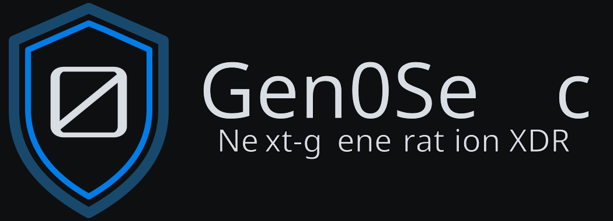
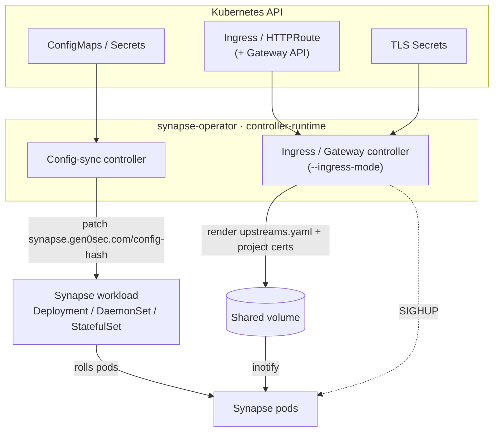

<p align="center">
  
</p>

<p align="center">
  <a href="https://github.com/gen0sec/synapse-operator/blob/main/LICENSE"></a> &nbsp;
  <a href="https://github.com/gen0sec/synapse-operator/releases"></a> &nbsp;
   &nbsp;
  <a href="https://docs.gen0sec.com/"></a> &nbsp;
  <a href="https://discord.gg/jzsW5Q6s9q"></a> &nbsp;
  <a href="https://x.com/gen0sec"></a>
</p>

<p align="center">
  <a href="https://discord.gg/jzsW5Q6s9q"></a>
  <a href="https://gen0sec.substack.com/"></a>
</p>

---

## Keep Synapse in Sync on Kubernetes

A Go [controller-runtime](https://github.com/kubernetes-sigs/controller-runtime) operator for running [Synapse](https://github.com/gen0sec/synapse) on Kubernetes. It runs in **two modes** from the same binary: a **config-sync controller** that rolls Synapse pods when their config changes, and an **Ingress + Gateway API controller** that renders native Kubernetes routing into Synapse's upstreams.

**What it does:**
- **Config-sync (default)** — hashes every ConfigMap/Secret matching a label selector and stamps the hash onto the Synapse workload, so Kubernetes rolls the pods whenever config content changes (no manual restarts)
- **Ingress / Gateway API mode** (`--ingress-mode`) — reconciles class-matched `Ingress` and Gateway API `HTTPRoute` objects into Synapse's v2 `upstreams.yaml` on a shared volume, hot-reloaded via inotify + `SIGHUP`
- **TLS projection** — projects referenced Ingress/Gateway TLS Secrets into Synapse's certificates directory, operator-owned and hot-reloaded. A certificate that cannot be written does not stop the render: the pair already on disk keeps serving (a new one is left out), a `CertificateNotWritten` event is recorded on the object that references it, and the render is retried after a minute
- **Status & HA** — optionally publishes load-balancer addresses on matched Ingresses and gates shared status writes behind a Lease when running more than one proxy replica
- **Helm-native** — keys off `app.kubernetes.io/name` being `synapse`, `synapse-proxy` or `synapse-agent`, so it plugs straight into Synapse Helm releases
- **SynapseProxy** (`--proxy-controller`, alpha) — runs a Synapse proxy from one typed resource: its configuration, Deployment, Service, routes and certificates. See [SynapseProxy](#synapseproxy)
- **SynapseAgent** (`--agent-controller`, alpha) — runs a Synapse agent on every selected node from one typed resource: its configuration and DaemonSet. See [SynapseAgent](#synapseagent)

> **Go 1.26+** · any conformant **Kubernetes** cluster · Gateway API CRDs required only for `--gateway-api`

---

## Quick start

### Build

```bash
GOOS=linux GOARCH=amd64 go build -o bin/synapse-operator
```

### Test

```bash
make test               # every package
make verify-generated   # fails if the CRDs or deepcopy code are stale
```

The API tests run against a local Kubernetes API server. Its binaries are downloaded on first use; set `KUBEBUILDER_ASSETS` to use ones already on disk.

After changing a type under `api/`, run `make generate manifests` and commit the result.

```bash
make e2e E2E_SYNAPSE_IMAGE=ghcr.io/gen0sec/synapse:<version>
```

runs a `SynapseProxy` end to end: it starts a k3s cluster in a container, installs the operator built from the working tree, and sends requests through the cluster's load balancer to the Synapse pods the operator creates. It needs Docker, `kubectl`, and a Synapse image, 0.8.8 or newer, that the local Docker has or can pull. The cluster gets a kubeconfig of its own; the one `kubectl` uses by default is not touched. See [`test/e2e`](test/e2e/).

### Container

```bash
docker build -t ghcr.io/<org>/synapse-operator:latest .
docker push  ghcr.io/<org>/synapse-operator:latest
```

Update `config/manager.yaml` with the pushed image reference.

### Deploy with Kustomize

```bash
kubectl apply -k config
```

Creates the `synapse-os` namespace, ServiceAccount, RBAC, and a single operator replica.

### Deploy with Helm (alongside Synapse)

```bash
helm repo add gen0sec https://helm.gen0sec.com
helm repo update

export GEN0SEC_API_KEY="REPLACE_ME"
helm upgrade --install synapse-stack gen0sec/synapse-stack \
  -n synapse --create-namespace \
  --set global.namespaces.synapse="synapse" \
  --set global.namespaces.operator="synapse-os" \
  --set synapse.image.repository="ghcr.io/gen0sec/synapse" \
  --set synapse.image.tag="latest" \
  --set synapse.synapse.gen0sec.apiKey="$GEN0SEC_API_KEY" \
  --set operator.enabled=true \
  --set operator.image.repository="ghcr.io/<org>/synapse-operator" \
  --set operator.image.tag="latest"
```

Verify, then trigger a config change and watch the rollout:

```bash
kubectl -n synapse-os rollout status deployment/synapse-operator
kubectl -n synapse edit configmap synapse-stack          # change any key
kubectl -n synapse rollout status deployment/synapse-stack
# the pod annotation synapse.gen0sec.com/config-hash updates
```

---

## Modes

The operator runs as **one** of three controllers per process, selected by `--ingress-mode` or `--config-sync`. All share the same manager, health probes, and optional namespace scoping.

> **Config-sync** is the default — it never touches routing, it only forces rollouts when watched config changes.
>
> **Ingress / Gateway API** turns native Kubernetes routing objects into Synapse's `upstreams.yaml` and keeps Synapse hot-reloaded in place.

| | Config-sync | Ingress / Gateway API |
|---|:---:|:---:|
| Flag | _(default)_ | `--ingress-mode` |
| Watches | ConfigMaps + Secrets (by label) | `Ingress` (+ `HTTPRoute` with `--gateway-api`) |
| Action | stamp config hash → roll workload | render `upstreams.yaml` → inotify + `SIGHUP` |
| TLS Secret projection | — | ✅ via `--certs-out` |
| Publishes LB status on Ingress | — | ✅ via `--publish-status-address` |
| One-shot initContainer prime | — | ✅ `--render-once` |
| Multi-replica shared-status HA | — | ✅ `--status-leader-election` |

> **The routes file is always a v2 file.** `--ingress-mode` and `--gateway-api` used to write Synapse's v1 schema unless an Ingress had `ssl-passthrough`. They now write the v2 schema every time, the file a `SynapseProxy` writes. Synapse MUST be 0.8.8 or newer: an older one refuses a v2 file with a host without a certificate, a `use-regex` path or `healthcheck: "false"`, and does not start on a refused first file. Upgrade Synapse first. The file name and `upstream.conf` do not change.
>
> What stops working: `server-alias: "*"` and a mid-name wildcard such as `www.*.example.com` are no longer a catch-all or a pattern; they are left out with `InvalidServerAlias`. A `use-regex` path (or a Gateway `RegularExpression` path) the operator refuses is left out with `UnsupportedMatch`: one Go cannot parse; one with a character class holding a character outside ASCII; one with a case-insensitive character outside ASCII; one with a character above 0x7f written by its number, or a character outside ASCII that cannot be printed; and one longer than 1024 bytes once written out. A path without header annotations no longer takes the headers of the path above it; set them on each Ingress. `--config-sync --ensure-files` creates a v2 placeholder (Synapse 0.7.0 or newer).
>
> Every `use-regex` path and every Gateway `RegularExpression` path is written in Go's canonical form. For the few expressions the two engines read differently, such as `\<` (a literal character in Go, a word boundary in Synapse), the meaning follows Go's reading. One exception: under `(?i)`, Go matches `s` and `k` to `ſ` (U+017F) and the Kelvin sign (U+212A) as well; Synapse matches ASCII letters only.
>
> What stays: every annotation means what it meant: plain HTTP unless `backend-protocol` asks for TLS, a probe unless `healthcheck: "false"`, 120 s to send, no fingerprints forwarded.
>
> A file that was already v2 because of passthrough now says the v1 values. A route with no TLS setting says `ssl_enabled: false` (plain HTTP, not chosen by port). `healthcheck: "true"` uses the global probe, not a TCP probe. `healthcheck: "false"` writes `type: none`. The read timeout is 120 s, not 60 s. Client fingerprints are not forwarded.
>
> To roll back, run operator 0.1.x again; the next render rewrites the file in v1.

### Path matching

In `--ingress-mode`, each Ingress/HTTPRoute path is rendered into a Synapse route by path type:

| Source | Rendered as |
|---|---|
| Ingress `Prefix` · Gateway `PathPrefix` | Synapse longest-prefix path (key = the path) |
| Ingress `Exact` · Gateway `Exact` | Approximated as a prefix (Synapse matches longest-prefix) + a warning event |
| Ingress `ImplementationSpecific` + `nginx.ingress.kubernetes.io/use-regex: "true"` | Regex route — `match_expr: http.request.path matches "<regex>"`, with `<regex>` in its canonical form |
| Gateway `RegularExpression` | Regex route — `match_expr: http.request.path matches "<regex>"`, with `<regex>` in its canonical form |
| `/.well-known/acme-challenge/<token>` (cert-manager HTTP-01 solver) | A plain-HTTP path of the host that serves the solver's name (`ssl_enabled: false`). A solver for the whole challenge directory on a host that has regex routes is a `match_expr` route under the key `acme:challenge` |

A solver's path is reached with **Synapse 0.7.1 or newer**. Before that, Synapse answered every path under `/.well-known/acme-challenge/` itself, ahead of any host's routes.

The canonical form is the expression as Go's regexp parser writes it back, which Synapse's engine reads the same way: `/v[0-9]+/.*` becomes `(?-s:/v[0-9]+/.*)`. An expression the operator refuses (Go cannot parse it, it holds a non-ASCII character class, a case-insensitive non-ASCII letter or a non-ASCII character written by its number or one that cannot be printed, or it is over 1024 bytes written out) is left out with an `UnsupportedMatch` warning, in every mode. Regex paths are **anchored at the start** (`^`) since they match from the beginning of the request path (the Kubernetes Ingress spec also requires the stored path to begin with `/`, so the leading `^` is supplied by the renderer). The path-map key for a regex route is a unique label; matching is driven entirely by `match_expr`. Header / method / query-param match conditions are not representable in Synapse's host+path model and are dropped with a warning event.

---

## SynapseProxy

> **Alpha** (`synapse.gen0sec.com/v1alpha1`): the API can still change. Off unless the operator runs with `--proxy-controller`.

A `SynapseProxy` is a Synapse proxy described by one resource. The operator renders its configuration, creates its Deployment, Service and ServiceAccount, and renders the routes and TLS certificates of the Ingresses that belong to it. Nobody edits a ConfigMap.

```yaml
apiVersion: synapse.gen0sec.com/v1alpha1
kind: SynapseProxy
metadata:
  name: edge
  namespace: edge
spec:
  image: ghcr.io/gen0sec/synapse:<version>   # 0.8.8 or newer
  replicas: 2
  service:
    type: LoadBalancer
  listeners:
    - name: http
      port: 80
      protocol: HTTP
    - name: https
      port: 443
      protocol: TLS
---
apiVersion: networking.k8s.io/v1
kind: IngressClass
metadata:
  name: edge
spec:
  controller: gen0sec.com/synapse
  parameters:            # which proxy serves this class
    apiGroup: synapse.gen0sec.com
    kind: SynapseProxy
    scope: Namespace
    namespace: edge
    name: edge
```

An Ingress with `ingressClassName: edge` is then served by that proxy, with the certificates its `tls` section names. It can be in any namespace the operator watches.

```console
$ kubectl get synapseproxies -n edge
NAME   READY   REASON    DESIRED   AVAILABLE   ADDRESS        AGE
edge   True    Applied   2         2           203.0.113.10   2m
```

`READY` is true when the pods run the spec as it is written. When they do not, `REASON` and the resource's conditions say why: a configuration that cannot be rendered, a rollout in progress, an object of the same name in the way.

### Install

```bash
kubectl apply -k config                    # the operator
kubectl apply -k config/proxy-controller   # the CRD, and the role the controllers need
```

then add `--proxy-controller` to the operator's arguments in `config/manager.yaml`. [`test/e2e/operator`](test/e2e/operator/) is a kustomization that does all three. When it starts, the operator checks that it can read `SynapseProxy` resources, and exits if it cannot, saying whether the CRD is missing or the role is. A role that is bound but incomplete gets past that: the controller that is refused something stops the operator a couple of minutes later, naming the kind it could not read.

### What to know

- **The pod is privileged and runs as root,** as the Helm chart's does, with packet capture, the firewall and the IDS on. Whoever may create a `SynapseProxy` in a namespace gets such a pod there, running the image they name. Whoever may create or change one also chooses `spec.hostNetwork`, `spec.nodeSelector`, `spec.tolerations` and `spec.affinity`. They choose which nodes the pod lands on, tainted ones included. They choose whether it joins the network namespace of its node. Create, update and patch rights on `SynapseProxy` MUST therefore go only to principals you trust with a root pod on those nodes.
- **Pod Security `baseline` or `restricted` refuses the pods, not the Deployment.** The Deployment is created, the pods never are, and the proxy never becomes Ready. The operator has no condition for this. `kubectl get synapseproxy` shows `Ready` as `False` with the reason `RollingOut`, and after the Deployment's progress deadline (ten minutes by default) `ProgressDeadlineExceeded`. The refusal itself is in the events and the `ReplicaFailure` condition of the Deployment's ReplicaSet (`kubectl describe replicaset`). Label the namespace `pod-security.kubernetes.io/enforce: privileged` for a proxy to run there. The label lifts Pod Security for every pod in the namespace, so run proxies in a namespace of their own.
- **A host belongs to one namespace.** The class decides which proxy gets an Ingress, and a class is cluster-scoped on purpose: a proxy receives the TLS private keys of every Ingress of its classes, from every namespace. Within one proxy, a host goes to the namespace that claimed it first, by when the proxy first saw the claim (then namespace and name). The proxy keeps that in a ConfigMap it controls, `<proxy>-host-claims`, with one line per namespace and host. Editing an old object to name a host is a new claim, aged from the render that sees it, and the object's creationTimestamp does not count; the first time the ledger is made, it is filled from the creation timestamps. A line stays for one hour after nothing claims the host, so that deleting and recreating an Ingress does not lose it; the host passes to the next claimant at once. A line expires an hour after a render first saw its claim absent, whether or not a render has run since: a claim that comes back after that hour is a new claim, aged from the render that sees it. A claim that was never seen absent keeps its age however old the line. While host ownership is off the ledger is neither read nor written; when it is turned on again, the lines keep their first-seen times and claims made in between are aged from that render. A namespace holds at most 1024 lines: its newest claims past that are not recorded and are aged afresh on every render, with a `HostClaimQuotaExceeded` warning on the proxy, so one namespace that names thousands of hosts cannot fill the ledger and make every later claim tie; if the ledger is still too big, lines new in that render are dropped first, then lines of claims no longer made, then the rest, each time from the namespace with the most bytes, and every line counts as long as it can get, with the longest time a claim can have been absent, so that a claim going absent never makes the ledger too big. New lines are therefore refused first, and a line that was there before is dropped only from a ledger that was already over the cap, for instance one edited by hand. What remains is that, while the ledger is full, two contested claims that are both new tie by namespace name. Deleting the ledger resets every age to the object's creation time, and whoever may write ConfigMaps in the proxy's namespace may write the ledger. A ledger that cannot be read fails the render and keeps the last routes; one that cannot be written does not stop the routes, is counted in `synapse_operator_host_claim_ledger_errors_total` and is retried in a minute. The names are the `rules[].host`, the `server-alias` values and the `spec.tls[].hosts` of its Ingresses, compared without case and without a trailing dot. Another namespace's Ingress that names the host loses that rule, alias or certificate, whatever its path or annotations (`use-regex`, `ssl-passthrough`, an ACME solver path), and gets a `HostnameConflict` warning that names the owner's namespace; `synapse_operator_host_conflicts_total` counts them. A wildcard held by an older claim holds the hosts it covers, but a newer wildcard does not take a host an older claim holds: a held name that the file has no routes for (its backend cannot be resolved, or an Ingress names it only in `spec.tls` or `server-alias`) and that a wildcard of another namespace or of none covers is written with no paths, and the proxy answers 404 for it itself. A namespace may spread its host over any number of Ingresses. Ownership is per proxy: two proxies can serve the same host to different namespaces. A Gateway's listener and route hosts are claims too (see "A host belongs to one namespace, Gateways included" below). When the owner's last Ingress for a host goes, the host passes to the next oldest claimant on the next render. An Ingress that names hosts in its rules and may use none of them shows no address in its status, and gets no `Programmed` event. Set `spec.hostOwnership` to `None` on a SynapseProxy to turn this off for it, so that namespaces share hosts as before; the default is `Namespace`.
- **Routes and certificates take about a minute to reach running pods.** They are delivered through mounted volumes, which the kubelet refreshes on its own schedule.
- **It takes Synapse 0.8.8 or newer.** An older Synapse refuses the routes file when a host has no certificate, a route is chosen by a regular expression or `healthcheck` is `false`, and then serves none of its routes.
- **An annotation does what it does in `--ingress-mode`.** Both write the same v2 file, which says plain HTTP to a backend unless `backend-protocol` asks for TLS, a probe unless `healthcheck` is `false`, 120 seconds for a backend to send, and nothing about the client in the request to it. `request-headers` and `response-headers` are for the routes of the Ingress that carries them: a path of another Ingress never takes them. A `server-alias` value with a space, a newline or another character a host cannot have is left out, with an `InvalidServerAlias` warning on the Ingress. So is a `*` anywhere but as the first label, as in `*.example.com`, and a bare `*` is no catch-all.
- **To take traffic on a node's own address,** set `spec.hostNetwork: true`. The pods then run in the network namespace of their node and each listener binds that node's port, as a DaemonSet with `hostNetwork` did, so a load balancer that connects to a node's public address reaches a real socket on the host and not the cluster's host-port rules (which a `LoadBalancer` Service on k3s uses). A node runs one such pod per listener port; a pod stays Pending on a node where the port is taken, for example by an older proxy, which is how a node is handed over: keep the old one off it. A rollout replaces the pods in place, one at a time (`maxSurge: 0`, `maxUnavailable: 1`), since a new pod cannot start beside the old one. The Service has to be of type `ClusterIP`. Synapse's internal services bind the node's loopback, so a second such proxy on a node needs its own `proxy.internal_services.port` in `spec.config`.
- **Behind a layer 4 load balancer that sends the PROXY protocol,** set `spec.proxyProtocol.enabled: true` (and, if the default does not suit, `timeoutMs`). The proxy then reads the header, v1 or v2, before the TLS handshake and takes the client address from it. `proxy.protocol` is refused in `spec.config`.
- **`spec.config` takes the Synapse settings that have no field.** A key the operator owns, such as `mode` or the listeners, is refused there and reported in the `ConfigValid` condition; it is never silently overridden. An invalid configuration changes nothing that is running.
- **Certificates come from the Ingresses' TLS Secrets,** for example from cert-manager. Synapse's built-in ACME client is not used. A certificate for a concrete host is stored as `<host>.crt` and `<host>.key`; one for a wildcard or no host as `<namespace>_<secret>.crt` and `.key`. A host named `cert`, `chain`, `fullchain` or `default` is stored the same way: Synapse names a file of the first three after its directory, and `default` is what a config written for an older operator may still name as its default certificate. The operator's own default certificate is `_default`, which no host can take. A custom `proxy.default_certificate` SHOULD name `_default` or a `<namespace>_<secret>` stem. A name longer than 249 characters is cut to 232 and followed by `_` and 16 hex digits of its hash, so that it fits a Secret key and a file name.
- **The proxy has a default certificate of its own.** The operator generates a self-signed one (CN `synapse-default`, no SANs, valid for a year) and stores it as `_default.crt` and `_default.key` beside the others. It is generated again only when it is missing, unparseable or within 30 days of expiry. A `SynapseProxy` serves it by default (`proxy.default_certificate: _default`; `spec.config` can name another). With `--ingress-mode`, the config is yours: set `default_certificate: _default` in it, or Synapse serves whichever certificate it reads first, which can be any tenant's. A client that sends no SNI, or a name no certificate matches, gets this certificate and sees it as untrusted.
- **Ingresses and, where its CRDs are installed, the Gateway API.** See [below](#gateway-api-for-a-synapseproxy) for what of it is served.
- **Not together with `--ingress-mode` or `--config-sync`** in one operator process.
- **With `--namespace`, only that namespace is seen.** A proxy elsewhere is not run, and an Ingress elsewhere is not served, whatever its class; nothing reports either.

### Gateway API for a `SynapseProxy`

Where the cluster has the Gateway API's CRDs, a proxy serves Gateways as well. A `GatewayClass` names the proxy, as an `IngressClass` does:

```yaml
apiVersion: gateway.networking.k8s.io/v1
kind: GatewayClass
metadata:
  name: edge
spec:
  controllerName: gen0sec.com/synapse
  parametersRef:          # which proxy serves this class
    group: synapse.gen0sec.com
    kind: SynapseProxy
    namespace: edge
    name: edge
---
apiVersion: gateway.networking.k8s.io/v1
kind: Gateway
metadata:
  name: web
  namespace: edge
spec:
  gatewayClassName: edge
  listeners:
    - name: http
      port: 80            # a port the SynapseProxy listens on
      protocol: HTTP
      allowedRoutes:
        namespaces:
          from: All
    - name: https
      port: 443
      protocol: HTTPS
      hostname: shop.example.com
      tls:
        certificateRefs:
          - name: shop-tls
      allowedRoutes:
        namespaces:
          from: All
```

An `HTTPRoute` attached to that Gateway is then served by the proxy. The rule the operator follows: what is programmed is exactly what was asked for, and what cannot be is said in the object's status. Nothing is routed more broadly than written.

| | Served |
|---|---|
| Listeners | `HTTP` and `HTTPS` (terminated), on a port the `SynapseProxy` listens on with that protocol |
| Who may attach | `allowedRoutes` by namespace (`Same`, `All`, `Selector`); a parent's `sectionName` and `port` |
| Hosts | exact names and wildcards; a route that names no host takes its listener's |
| Matches | `PathPrefix`, `Exact` and `RegularExpression` paths, `method`, headers (`Exact` and `RegularExpression`) and query parameters (`Exact`), in the precedence the API gives them |
| Backends | Services, with weights; one in another namespace needs a `ReferenceGrant` |
| Certificates | a listener's `certificateRefs`; one in another namespace needs a `ReferenceGrant` |
| Filters | request and response headers: `set`, `add` and `remove` |
| Status | `Accepted`, `Programmed`, `ResolvedRefs` and `PartiallyInvalid`; attached routes per listener; the proxy's addresses |

**What cannot be done is one of two things, and they are not treated alike.**

- **A rule the proxy cannot carry out keeps its requests.** They are answered `404`, and are not served by another rule that happens to match them too: a rule for `/admin` that cannot be served does not hand `/admin` to the rule for `/`. The route says `PartiallyInvalid`, or `Accepted: False` when nothing of it is served. This is a rule with:
  - a redirect, URL-rewrite or mirror filter, or a filter on a backend;
  - a header filter Synapse does not take: one that names a framing or hop-by-hop header (`Content-Length`, `Transfer-Encoding`, `Connection`, `Keep-Alive`, `TE`, `Trailer`, `Upgrade`, `Proxy-Connection`) or `Sec-WebSocket-Key` or `Sec-WebSocket-Accept`, a name that is not a header's or has a `*` in it, or a value with a control character in it;
  - timeouts, retries or session persistence;
  - a backend that cannot be used: one that does not exist, is not a Service, or is in another namespace without a `ReferenceGrant`. One such backend among several is enough. Synapse cannot fail a share of the requests, and the other backends were not asked to take them. The route says which in `ResolvedRefs`.
- **A match the proxy cannot evaluate is left out,** and what it would have matched is served as if the match were not there, by the route's other matches and by other routes. This is a query parameter matched by a regular expression, a query parameter whose name or value would be percent-encoded in a URL, and a regular expression that cannot be used.

**Limits that come from how Synapse routes:**

- **A header's value is matched whole, and as it is.** `Exact` is the value byte for byte, case included. A header sent on several lines matches when one of them fits; one line with commas in it is one value.
- **A query parameter is matched as the client wrote it.** `beta=1` matches that parameter wherever it stands in the query string, and not `beta=10`. It does not match `beta=%31`, which says the same in another spelling; a name or a value that has to be percent-encoded is not served for that reason. A parameter given more than once matches when one of its values does.
- **Regular expressions are ASCII, and bounded.** Synapse's regex engine runs without Unicode: a character class may not hold a character outside ASCII, and a letter outside ASCII has no other case. An expression may be 1024 bytes with its classes written out as ranges. A `RegularExpression` match ranks between `Exact` and `PathPrefix`.
- **A route belongs to a host, not to a listener.** One attached to a single listener of a Gateway is served on every listener of the proxy, the plain-HTTP ones included.
- **A route that names no host needs a listener that names one.** Synapse has no host that stands for all others. On a listener without a hostname such a route is not served, and says so.
- **A host an Ingress of the same proxy routes is taken.** An `HTTPRoute` for it is not accepted (`HostnameConflict`).
- **A host belongs to one namespace, Gateways included.** A listener's `hostname` is claimed for the Gateway's namespace, and so are a route's hosts through a listener that admits the route (`allowedRoutes`), whatever the route's own namespace is. Ownership is per namespace across all its Gateways: routes of several namespaces on one Gateway do not refuse each other, but a route of another namespace cannot reach, through a listener with no hostname or a wildcard, a host that the Gateway's namespace names more specifically through its own Ingresses, listeners or routes. A claim is aged by the ledger like an Ingress's, under the Gateway's namespace. When the ledger is first made, it is seeded from the later of the object's and the Gateway's creation time. When an older claim of another namespace holds the host, the listener says `Accepted: False` (`HostnameConflict`) and is not programmed, and a route says `HostnameConflict` (also for a host named more specifically in the Gateway's namespace), or `PartiallyInvalid` when it keeps other hosts. An older Gateway also wins a host from a newer Ingress of another namespace. A name the Gateway's namespace names, that has no route of its own under a wildcard any route of another namespace brings in, is written with no paths, so that the wildcard does not serve it.
- **`/health` is Synapse's own.** It answers that path itself, on every host, and a backend's `/health` is not reached through the proxy.

**A Gateway that asks for more than is done says so.**

- With `spec.addresses`, `spec.infrastructure.parametersRef` or `spec.tls.backend` the Gateway is not accepted, and none of its listeners is served.
- With client certificates (`spec.tls.frontend`) or with `tls.options` an HTTPS listener is not served. A listener that was to ask for a client certificate and does not would be open to everyone.
- TLS passthrough, and every kind of route but `HTTPRoute`, are not served.
- `BackendTLSPolicy`, `ListenerSet` and default Gateways (`useDefaultGateways`) are not implemented. Such objects get no status from this controller.

**Statuses are taken back.** When a `GatewayClass` names a `SynapseProxy` that does not exist, the class says `InvalidParameters`, its Gateways go back to `Pending` without addresses, and routes lose their entries for those Gateways.

**When the operator starts** it looks for the Gateway API's CRDs. Installed later, they are found after a restart. If they are there and the operator's role does not let it read them, it serves Ingresses only and logs what it is missing: the role is in `config/proxy-controller`.

The Gateway API conformance suite has not been run against it.

---

## Architecture



---

## SynapseAgent

> **Alpha** (`synapse.gen0sec.com/v1alpha1`): the API can still change. Off unless the operator runs with `--agent-controller`.

A `SynapseAgent` is a Synapse agent (packet capture, firewall and IDS, no proxy) that runs on every node it selects, described by one resource. The operator renders its configuration into a Secret and creates the ServiceAccount and the DaemonSet. Nobody edits a ConfigMap.

```yaml
apiVersion: synapse.gen0sec.com/v1alpha1
kind: SynapseAgent
metadata:
  name: agent
  namespace: synapse
spec:
  image: ghcr.io/gen0sec/synapse:<version>
  platform:
    apiKeySecretRef:          # optional
      name: gen0sec-api-key
      key: api-key
```

Only `spec.image` is required. Without `spec.platform.apiKeySecretRef` the agent runs with no platform API key. The Secret MUST be in the agent's namespace.

```console
$ kubectl get synagent -n synapse
NAME    READY   REASON    NODES   READY-PODS   UPDATED   AGE
agent   True    Applied   3       3            3         2m
```

`synagent` is the short name of `synapseagents`. `-o wide` adds `IMAGE` and `CONFIG` (the hash of the rendered configuration). `READY` is true when the DaemonSet runs the spec as it is written. It does not say that Synapse loaded the configuration, or that it attached to every interface (see Status). When it is not true, `REASON` and the resource's conditions say why.

### Install

```bash
kubectl apply -k config                    # the operator
kubectl apply -k config/crd                # the CRDs
kubectl apply -k config/agent-controller   # the role the agent controller needs
```

Where the `SynapseProxy` controller is installed too, `config/proxy-controller` already carries both CRDs: apply it and `config/agent-controller`, and skip `config/crd`. Then add `--agent-controller` to the operator's arguments in `config/manager.yaml`. The ClusterRole and its binding are both named `synapse-operator-agent-controller`, and bind the ServiceAccount `synapse-operator` in `synapse-os`. When it starts, the operator checks that it can read `SynapseAgent` resources, and exits with an error if it cannot. The error names `config/crd` when the CRD is missing, and `config/agent-controller` when the listing is forbidden. It is refused with `--ingress-mode` and `--config-sync`, with exit 1.

### What to know

- **The pod is privileged and runs as root,** as the Helm chart's agent does, because packet capture, the kernel firewall and the IDS need it. The container is `privileged`, adds `SYS_ADMIN`, `NET_ADMIN`, `BPF` and `SYS_RESOURCE`, runs with `hostNetwork` unless `spec.hostNetwork` is `false`, and with `hostPID` unless `spec.hostPID` is `false`. Its seccomp and AppArmor profiles are `Unconfined`. Whoever may create or change a `SynapseAgent` chooses the image, the nodes and the pod's scheduling. Create, update and patch rights on `SynapseAgent` MUST therefore go only to principals you trust with a root pod on those nodes.
- **Pod Security `baseline` or `restricted` refuses the pods, not the DaemonSet.** Label the namespace `pod-security.kubernetes.io/enforce: privileged`, and run agents in a namespace of their own.
- **It takes Kubernetes 1.30 or newer,** because the pod sets the `appArmorProfile` field. There is no annotation fallback.
- **Three hostPaths are mounted** (two with `spec.hostNetwork: false`, which drops `/sys/fs/bpf`): `/sys/fs/bpf` (bidirectional, for the BPF pins), `/sys/kernel/debug` (read-write) and `/lib/modules` (read-only). Each is created when it is missing. Only `/lib/modules` is read-only. `/sys/kernel/btf` is not mounted, on purpose: a privileged pod already sees the host's sysfs, and Synapse treats BTF as optional.
- **The node's kernel MUST support eBPF and XDP.** XDP needs IPv6 on the interface to attach. Where it is off, Synapse writes `0` to `/proc/sys/net/ipv6/conf/<iface>/disable_ipv6` and retries. That changes the node's interface setting, and it stays changed. The attach fails only if that write fails or IPv6 is disabled at boot (`ipv6.disable=1`). Synapse then falls back without XDP (AF_PACKET capture) and `READY` still goes `True`. Check the pod's log.
- **There is no Service and there are no probes.** An agent listens on nothing. `READY` follows the DaemonSet, not a health check. The ServiceAccount has no token mounted and no RBAC: the agent never talks to the Kubernetes API.
- **Defaults of the spec:**
  - `spec.tolerations` unset tolerates every taint, so the agent runs on every selected node. An explicit `tolerations: []` tolerates none.
  - `spec.hostNetwork` unset is `true`.
  - `spec.hostPID` unset is `true`.
  - `spec.ids.enabled` unset is `true`. Synapse's own default is `false`.
  - `spec.updateStrategy` unset is a rolling update with `maxUnavailable: 1`, one node at a time.
  - `spec.nodeSelector` always gets `kubernetes.io/os: linux`. A selector that says another value is refused.
- **`spec.hostNetwork: false` takes the agent off the node's network.** The pod gets its own network namespace and no bpffs of the node. With `network.iface: auto` the agent picks the pod's own interface. It inspects and protects only the traffic of that pod. Synapse's XDP dispatcher always pins under `/sys/fs/bpf/hillock/xdp`, so without a bpffs XDP never attaches. Capture uses AF_PACKET and the firewall uses nftables or iptables. IDS hot changes, HOME_NET changes from node churn included, take effect only at the next restart. Switching an existing agent leaves the XDP link, tc programs and pinned maps of the earlier pod on the node. To clear them, wait until the switch has rolled that node (its pod runs with `hostNetwork: false`), then drain the node and reboot it. Before that, kubelet restarts the old pod after the reboot and it pins again. The bpffs lives in memory, and XDP and tc attachments do not survive a reboot. `synapse --force-stop`, run once the node has rolled, is an alternative only on a node where no CNI uses tc or XDP. It sweeps the whole node. It detaches every XDP program and removes every clsact qdisc, with all its tc filters, on every interface, the CNI's included. It removes all Synapse and hillock pins. It stops every Synapse process on the node, proxies included (SIGTERM, then SIGKILL after 10 s if one is still alive). Run it in the node's network and PID namespaces with the node's `/sys/fs/bpf`: a node shell, or a privileged pod with `hostNetwork`, `hostPID` and a `/sys/fs/bpf` hostPath. HOME_NET is still computed cluster-wide.
- **`spec.config` takes the Synapse settings that have no field,** in the shape of Synapse's own configuration file. A key the operator owns is refused and reported in the `ConfigValid` condition. It is never silently overridden. An invalid configuration changes nothing that is running. The owned keys are `mode`, `daemon.enabled`, `proxy` and its alias `pingora`, `arxignis` (use `platform`), `firewall.ids` (use the top-level `ids`), `logging.level`, `platform.api_key`, `platform.identity.enabled`, `platform.identity.cluster`, `network.ifaces`, `ids.enabled`, `ids.enforce_block` and `ids.address_vars.HOME_NET`. Other keys under these sections, such as `ids.address_vars.CUSTOM`, are allowed.
- **`network.ip_version` has no field.** Synapse does not act on it. It MAY be set in `spec.config`.
- **`spec.capture.interfaces` writes `network.ifaces`.** Synapse ignores `network.iface` beside it, so a raw `network.iface` in `spec.config` is refused when interfaces are set.
- **HOME_NET.** A typed `spec.ids.homeNet` wins. Its entries MUST be IP addresses or CIDRs; the operator refuses anything else, such as `any`, a comma or a bracket, and names the entry. Without it the operator computes HOME_NET from the nodes' addresses, their PodCIDRs and the LoadBalancer IPs of Services, plus the private-network supernets, and follows the cluster as it changes. With `ids.enabled` false, every such change (a node joins or leaves, a load balancer IP changes) rolls the DaemonSet on every node. A typed `spec.ids.homeNet` stops that.
- **A typed `spec.ids.homeNet` replaces the computed list.** HOME_NET also feeds Synapse's never-ban guard. A short list can let `enforceBlock` ban the cluster's own nodes or a load balancer IP. The list SHOULD cover the nodes, the pods and the load balancers.
- **With `--namespace`, only that namespace is seen.** An agent elsewhere is not run, and nothing reports it. The computed HOME_NET counts only the LoadBalancer Services of that namespace.
- **The agent owns three objects:** the Secret `<name>-config`, the ServiceAccount `<name>` and the DaemonSet `<name>`. Each has an owner reference to the agent, and they go with it.

### Custom IDS rules

`spec.ids.rules` lists up to 16 sources of rule files. Each source is a `configMapRef` or a `secretRef` in the agent's namespace, and may name `keys`. Without `keys`, every key that ends in `.rules` is used.

```yaml
spec:
  ids:
    rules:
      - configMapRef: {name: local-rules}
        keys: [web.rules]
      - secretRef: {name: paid-rules}
```

- **The operator copies the files into the config Secret.** Each one is listed in `ids.rule_paths` after the default glob, as `/etc/synapse/config/rules.<n>.<key>.<hash>.rules`. The hash is of the content.
- **An edit is hot.** The rules change the config Secret in place and no pod is replaced. See "Hot reload and rollouts" for the delay and for AF_PACKET.
- **The files add up to 900 KiB at most.** Keep larger sets in the platform's rules.
- **A source the operator cannot read changes nothing that runs.** `ConfigValid` is false with `RulesSourceNotFound` (a missing ConfigMap or Secret), `RulesKeyNotFound` (a named key that is absent) or `RulesTooLarge`.
- **The operator needs `get`, `list` and `watch` on ConfigMaps.** `config/agent-controller/rbac.yaml` grants it.

### Hot reload and rollouts

Six IDS settings are hot: `rule_paths`, `address_vars` (HOME_NET included), `port_vars`, `flow_timeout_secs`, `max_flows` and `enforce_block`, under `ids` and `firewall.ids`. A change confined to them updates the config Secret in place. The pods are not replaced. Synapse reloads the file once kubelet has synced the mounted Secret, which takes up to about a minute.

Every other change rolls the DaemonSet, one node at a time by default. The pod template carries a hash of the configuration without the six settings (`synapse.gen0sec.com/restart-config-hash`), so only a change to the rest replaces pods. A new image, a new resource limit and the like roll it in the usual way.

When `ids.enabled` is false, every change rolls, since no IDS worker would reload the file.

The hot swap runs only in the XDP IDS worker. Under AF_PACKET, a hot change never reaches a running pod. It takes effect at the next restart, including a HOME_NET change, which also feeds the never-ban guard. Restart it yourself: `kubectl -n <ns> rollout restart daemonset/<name>`.

### Status

| Condition | Meaning |
|---|---|
| `ConfigValid` | `True` (`Rendered`) when the spec renders to a Synapse configuration. `False` carries `InvalidConfig` (a refused key, an entry that is not an address, bad text), `SecretNotFound` or `SecretKeyNotFound` (the API-key reference), `RulesSourceNotFound`, `RulesKeyNotFound` or `RulesTooLarge` (`spec.ids.rules`) |
| `Ready` | The DaemonSet runs the spec as it is written |

Reasons of `Ready`:

| Reason | Meaning |
|---|---|
| `Applied` | The DaemonSet runs the current template and every pod is available. The Secret is applied, but kubelet may not have synced the file yet, and Synapse may not have reloaded it. A hot change is not confirmed by this |
| `RollingOut` | The DaemonSet is not yet observed, or not every pod runs the current template or is available |
| `NoMatchingNodes` | No node matches the node selector and tolerations |
| `ConfigInvalid` | `ConfigValid` is false. What runs is left as it is |
| `NameCollision` | An object of the same name that the agent does not own is in the way. Nothing is written until it is gone |

`synapse_operator_agent_ready{namespace,name}` is 1 while `Ready` is true and 0 otherwise. The series is deleted with the agent.

### Migrating from the Helm agent

The `agent.enabled` toggle exists only in the `synapse-stack` chart (an alias of the `synapse` subchart, off by default). For a standalone `synapse` release that runs as the agent, uninstall that release instead.

Both paths leave a window. Pick one.

**Overlap first** keeps the node protected, and costs a window of two agents. What happens depends on the Helm agent:

- Without the `/sys/fs/bpf` mount (the chart's default), the second attach is either refused, so the new agent skips the interface, or it replaces the Helm agent's program, depending on the attach mode.
- With the mount, the new agent opens the pinned link and swaps its program in. Nothing is refused, and the two agents share the pins and run two firewalls.

1. Create the `SynapseAgent` and wait for `READY` to be `True`.
2. Remove the Helm agent (`agent.enabled=false`).
3. Restart the new agent: `kubectl -n <ns> rollout restart daemonset/<name>`. The attach happens when the pod starts, so an interface it skipped stays skipped until then.
4. Read the pod's log. Look for these lines:
   - `XDP: skipped N interface(s) that already have a foreign XDP program`: an interface was skipped.
   - `Failed to attach XDP to '<iface>': ...`: the attach failed, for example when the Helm agent holds a pinned link.
   - `thalamus IDS capture auto-resolved to AF_PACKET recvfrom (XDP unavailable)`: the IDS fell back.
   - `XDP/BPF: no interface attached`: no interface got XDP.

   Synapse then falls back to AF_PACKET for the IDS and to nftables or iptables for the firewall, and `READY` is still `True`.

**Gap first** has no overlap and no skipped interface, and costs a node that is unprotected between the two steps. Remove the Helm agent, then create the `SynapseAgent`. It is the simpler path where a short gap is acceptable.

The operator's objects carry no `app.kubernetes.io/name` label, so the chart's selectors, and the config-hash controller's `--label-selector`, never match them.

A `SynapseAgent` and a `SynapseProxy` MUST NOT share a name in one namespace. They would collide on the ServiceAccount, and the operator refuses with `NameCollision`.

---

## Configuration flags

**Common**

| Flag | Default | Purpose |
|---|---|---|
| `--metrics-bind-address` | `:8080` | Metrics endpoint address |
| `--health-probe-bind-address` | `:8081` | Health probe address |
| `--leader-elect` | `false` | Leader election for the controller manager |
| `--namespace` | _(all)_ | Restrict the watch to one namespace |

Before this default, it was `app.kubernetes.io/name=synapse`. An install that does not pass `--label-selector` now also selects workloads named `synapse-proxy` and `synapse-agent`. The first reconcile after the upgrade stamps a hash on each of them, which rolls each once. When a proxy and an agent share a namespace, they also share that namespace's hash, so a change to the agent's config rolls the proxy: set `--per-workload-config-hash` to avoid it.

**Config-sync mode**

| Flag | Default | Purpose |
|---|---|---|
| `--label-selector` | `app.kubernetes.io/name in (synapse,synapse-proxy,synapse-agent)` | Selects config sources and workloads. Objects controlled by one of the operator's own resources (`synapse.gen0sec.com`) are left alone even when they match: the controller for that resource rolls them |
| `--config-hash-annotation` | `synapse.gen0sec.com/config-hash` | Annotation key for the hash |
| `--ignore-configmap-keys` | `upstreams.yaml` | Comma-separated ConfigMap keys excluded from the hash |
| `--ignore-secret-keys` | _(none)_ | Comma-separated Secret keys excluded from the hash |

**SynapseProxy**

| Flag | Default | Purpose |
|---|---|---|
| `--proxy-controller` | `false` | Run [`SynapseProxy`](#synapseproxy) resources. Needs the CRD and the role in [`config/proxy-controller`](config/proxy-controller/). Composable with the default config-sync controller and the resolvers; refused with `--ingress-mode` and `--config-sync` |
| `--cluster-domain` | `cluster.local` | Cluster DNS domain, for a backend that has no cluster IP |

**SynapseAgent**

| Flag | Default | Purpose |
|---|---|---|
| `--agent-controller` | `false` | Run [`SynapseAgent`](#synapseagent) resources. Needs the CRD in [`config/crd`](config/crd/) and the role in [`config/agent-controller`](config/agent-controller/). Composable with the default config-sync controller, `--proxy-controller` and the resolvers; refused with `--ingress-mode` and `--config-sync` |

**Ingress / Gateway API mode** (`--ingress-mode`)

| Flag | Default | Purpose |
|---|---|---|
| `--render-once` | `false` | One-shot: render `upstreams.yaml` and exit (initContainer prime) |
| `--ingress-class` | `synapse` | `spec.ingressClassName` this controller serves |
| `--upstreams-out` | `/shared/upstreams.yaml` | Path of the rendered upstreams file (sidecar layout) |
| `--upstreams-out-configmap` | _(none)_ | Central layout: write the rendered `upstreams.yaml` to this ConfigMap (`namespace/name`) instead of a file. Only the `upstreams.yaml` key is updated; other keys are preserved. Synapse reloads from its ConfigMap mount. |
| `--resolve-backend-cluster-ips` | `false` | Emit `<clusterIP>:port` instead of `<svc>.<ns>.svc.<cluster-domain>:port`, so Synapse skips backend DNS (falls back to the FQDN for headless / ExternalName / unallocated Services) |
| `--cluster-domain` | `cluster.local` | Cluster DNS domain for backend FQDNs |
| `--certs-out` | _(disabled)_ | Directory to project referenced TLS Secrets into |
| `--gateway-api` | `false` | Also reconcile Gateway API (requires the CRDs) |
| `--publish-status-address` | _(none)_ | IPs/hostnames to publish on matched Ingresses' status |
| `--reload-process-name` | `synapse` | argv0 of the co-located proxy to `SIGHUP` |
| `--status-leader-election` | `false` | Only the Lease holder writes shared status (>1 replica) |
| `--status-leader-election-id` | `synapse-ingress-status` | Lease name for the shared-status election |
| `--leader-election-namespace` | `$POD_NAMESPACE` | Namespace for the shared-status Lease |

**Config-sync mode** (`--config-sync`) — the thin reload sidecar

| Flag | Default | Purpose |
|---|---|---|
| `--watch-configmap` | _(required)_ | ConfigMap to project, as `namespace/name`. Repeatable. |
| `--out-dir` | `/shared` | Directory to project ConfigMap keys into (the volume shared with synapse) |
| `--sync-keys` | _(all)_ | Comma-separated data keys to project |
| `--sync-once` | `false` | One-shot: project once, guarantee `--ensure-files`, exit (initContainer) |
| `--ensure-files` | `upstreams.yaml` | Filenames that must exist in `--out-dir` before synapse starts. A missing one is created as an empty v2 document (Synapse 0.7.0 or newer) |
| `--reload-process-name` | `synapse` | argv0 of the co-located proxy to `SIGHUP` |
| `--reload-debounce` | `500ms` | Coalesce SIGHUP bursts |

### Why this mode exists

A ConfigMap *mount* is not a real-time delivery mechanism. kubelet re-projects a mounted ConfigMap on its own sync loop, so the delay scales with the kubelet's `syncFrequency`, which defaults to **1m**. In central mode nothing signals the proxy either: `SignalReload` is disabled whenever `--upstreams-out-configmap` is set, and `upstreams.yaml` sits in `--ignore-configmap-keys` so the config-hash controller deliberately does not roll the pods. Delivery depends entirely on kubelet propagation.

Config-sync reads the ConfigMap **through the API** instead, collapsing that to a single watch event:

```
ConfigMap write -> watch event -> write <out-dir>/<key> -> SIGHUP
```

which lands well inside a second. Synapse is untouched — it still just reads a file and reloads.

Measured on a single-node k3s cluster: Ingress created → proxy actually serving the route, at both the default `syncFrequency` and a tuned-down one.

**`syncFrequency: 1m` (kubelet default), n=5**

| | min | median | max |
|---|---|---|---|
| ConfigMap mount | 55.151s | **69.600s** | 75.497s |
| config-sync sidecar | 0.159s | **0.190s** | 0.254s |

**`syncFrequency: 10s` (tuned), n=10**

| | min | median | max |
|---|---|---|---|
| ConfigMap mount | 2.555s | **6.572s** | 8.573s |
| config-sync sidecar | 0.157s | **0.189s** | 0.270s |

The mounted path tracks `syncFrequency` — a 6x shorter sync loop bought a 10.6x lower median — while the sidecar is **flat at ~0.19s** across both. That is the point: the sidecar does not shorten the kubelet leg, it removes it. It reads the ConfigMap through the API and writes to an `emptyDir`, which kubelet never re-projects.

The median worst case exceeds `syncFrequency` itself (75.5s against a 60s loop) because the total is the remaining sync interval plus jitter, the remount, and synapse's own 500ms settle debounce.

Isolating the kubelet leg alone — ConfigMap write until the file changes inside the pod — the sidecar lands in **7–9ms**.

### Deployment requirements

- **`shareProcessNamespace: true`** on the pod, so the sidecar can see the synapse PID.
- **`runAsUser: 0`** on the sidecar container. The operator image is distroless nonroot (`USER 65532`) while synapse runs as root, so `syscall.Kill` returns `EPERM` without it.
- **`appArmorProfile: {type: Unconfined}`** on the sidecar, on any AppArmor-enforcing host (most Ubuntu/Debian installs). uid parity is *not* sufficient: the sidecar runs under containerd's default AppArmor profile, which only permits signalling peers in the same profile, while a privileged synapse is unconfined. The kernel then denies the signal regardless of uid or `CAP_KILL`:
  ```
  apparmor="DENIED" operation="signal" profile="cri-containerd.apparmor.d" signal=hup peer="unconfined"
  ```
  Failure here is degraded rather than fatal — synapse still picks the file up via its own inotify watch, just after the 500ms settle debounce instead of immediately.
- **A `--sync-once` initContainer.** Not optional: synapse-proxy does a blocking initial read of its upstreams file and, if that read fails, aborts its whole background service *without ever establishing a file watch* — so a pod that starts before the file exists stays deaf to every later update rather than recovering.
- **Metrics/health binds disabled** (the mode forces `0` unless overridden). synapse binds `:8080` for health in the same pod netns, which collides with the operator's metrics default.
- **RBAC**: `configmaps: get,list,watch` in the namespace. It cannot be narrowed to a single ConfigMap — `resourceNames` is ignored for `list`/`watch`, which a watch-based informer requires.

A missing source ConfigMap is **not** an error and never prunes files: leaving the last-good `upstreams.yaml` in place degrades to stale routing, whereas truncating it takes every route down at once.

### Migrating an existing deployment

Nothing changes on the operator side. Central mode keeps rendering into the
same ConfigMap, so the sidecar is purely additive on the proxy pod — you can
migrate one workload at a time, and the old mounted path stays valid
throughout, which is what makes rollback trivial.

The two capabilities are independent switches. `--config-sync` changes how
config is *delivered*; `--resolve-backend-endpoints` changes how backends are
*addressed*. Adopt either alone.

**Phase 0 — upgrade synapse first.** Take a build with the atomic reload
publication fix before anything else. It is a no-op at today's reload rate
and needs no config change, but the later phases raise the reload rate, and
the older clear-then-repopulate applier has a window where a concurrent
lookup misses and the request 502s. Order matters here.

**Phase 1 — delivery (`--config-sync`).** A pod-spec change, so it takes a
rollout. Start from `examples/config-sync-values.yaml` in the synapse-stack
chart; the moving parts are:

| | |
|---|---|
| `proxy.shareProcessNamespace` | `true`, so the sidecar can see the synapse PID |
| `proxy.volumes` / `volumeMounts` | a `shared` `emptyDir` mounted at `/shared` in both containers |
| `proxy.initContainers` | operator with `--config-sync --sync-once --ensure-files=upstreams.yaml` |
| `proxy.extraContainers` | the long-running sidecar, `runAsUser: 0` **and** `appArmorProfile: Unconfined` |
| `proxy.configSync.rbac.create` | `true` — `configmaps: get,list,watch` in the namespace |
| `proxy.synapse.config` | point `proxy.upstream.conf` at `/shared/upstreams.yaml` |

Leave the ConfigMap projection in place. Once `conf` points at `/shared` the
mounted `upstreams.yaml` is inert, but keeping it means reverting is a values
change rather than a re-plumb.

Verify: the sidecar logs `SIGHUP → reload` (not a permission error), synapse
logs `Loading upstreams configuration from: /shared/upstreams.yaml`, and an
Ingress edit is served in well under a second.

**Phase 2 — addressing (`--resolve-backend-endpoints`).** Operator-side flag
plus the `endpointslices` RBAC rule. Verify the rendered `upstreams.yaml`
flips from one `<svc>.<ns>.svc.<domain>:<servicePort>` entry to a sorted list
of `<podIP>:<targetPort>`. **Check the port**: pods listen on `targetPort`,
so a Service of `80 → targetPort 8080` must render `:8080`. If it renders
`:80`, the mapping is wrong and every request fails.

Roll back either phase independently by reverting the values; the ConfigMap
is maintained the whole time.

**Things that bite:**

- The `--sync-once` initContainer is **not optional**. synapse does a
  blocking initial read of its upstreams file and, if that read fails, aborts
  its background service without ever establishing a file watch — a pod that
  starts before the file exists stays deaf to every later update rather than
  recovering.
- `appArmorProfile: Unconfined` is required on any AppArmor-enforcing host.
  uid parity alone is not enough; see **Deployment requirements** above. The
  `appArmorProfile` field needs Kubernetes 1.30+, otherwise use the
  `container.apparmor.security.beta.kubernetes.io/<container>: unconfined`
  annotation.
- RBAC cannot be narrowed to a single ConfigMap — `resourceNames` is ignored
  for `list`/`watch`, which a watch-based informer requires. If read on every
  ConfigMap in the namespace is unacceptable, put the rendered ConfigMap in a
  namespace of its own.
- Don't let the sidecar bind a port synapse already uses; it defaults its
  metrics and health binds to off for this reason.
- `config.yaml` still arrives via the ConfigMap mount. That is deliberate —
  most of it is restart-only and a change there rolls the pod anyway, and a
  fresh pod is populated at mount time rather than on the sync loop. Add it to
  `--sync-keys` if you want it delivered the same way.

### Endpoint-backed upstreams

`--resolve-backend-endpoints` (ingress-mode) renders the **ready pod IPs** from EndpointSlices as the server list, instead of a single Service address.

Without it the renderer emits a Service FQDN and synapse resolves it through its in-process DNS cache, which pins the **first A record only**, is configured once at startup, and does not evict on a failed re-resolve — so a replaced pod can keep receiving traffic long after it is gone. Pod IPs are literals, so synapse never resolves them at all, and a pod change re-renders immediately.

Details that matter:

- The port comes from the **EndpointSlice**, not the Service. Pods listen on `targetPort`; pairing a pod IP with the Service port fails on every request.
- All slices for a Service are unioned (by the `kubernetes.io/service-name` label) and the result is **sorted** — API ordering is unstable, and an unsorted list would make every reconcile look like a change.
- `Ready == nil` counts as ready (the API contract for unknown readiness); only an explicit `false` excludes, as does `Terminating`.
- Dual-stack renders IPv4 when any IPv4 endpoint exists, otherwise IPv6. Unioning both would enter each pod twice.
- An empty result **falls back** to ClusterIP/FQDN rather than rendering an empty server list, which would be a 502 for every request to that host.
- Requires `discovery.k8s.io/endpointslices: get,list,watch`. The watch is only registered when the flag is set.

---

## Documentation

| | |
|---|---|
| [Gen0Sec Docs](https://docs.gen0sec.com/) | Product documentation and guides |
| [Synapse](https://github.com/gen0sec/synapse) | The NDR/proxy this operator manages |
| [`config/`](config/) | Kustomize deployment: namespace, ServiceAccount, RBAC, manager |
| [`config/proxy-controller/`](config/proxy-controller/) | What `--proxy-controller` needs on top: the `SynapseProxy` CRD and its role |
| [`test/e2e/`](test/e2e/) | End-to-end test of a `SynapseProxy` on k3s |
| [`SECURITY.md`](SECURITY.md) | Security policy and disclosure |

---

## Thank you!

- [Kubernetes SIGs](https://github.com/kubernetes-sigs/controller-runtime) for controller-runtime
- [Kubernetes Gateway API](https://github.com/kubernetes-sigs/gateway-api) for the Gateway API
